# EasyShop

### Plataforma de comercio electrónico personalizable para emprendedores

## Sobre el proyecto

EasyShop, desarrollado por el equipo Ecode, es una plataforma de comercio electrónico que permite a los emprendedores administrar y personalizar sus propias tiendas en línea sin necesidad de tener conocimientos de programación.

Su principal característica es la posibilidad de adaptar tanto la identidad visual como las funcionalidades de cada tienda según las necesidades del negocio.

El proyecto fue desarrollado colaborativamente en el contexto académico de Ingeniería Civil Informática de la Universidad Autónoma de Chile.

## Tiendas desplegadas

Las siguientes tiendas fueron implementadas utilizando EasyShop. Cada una cuenta con su propia identidad visual, contenido y configuración.

### Maché

Tienda orientada al diseño y comercialización de productos personalizados.

| Catálogo y filtros | Productos |
|---|---|
| 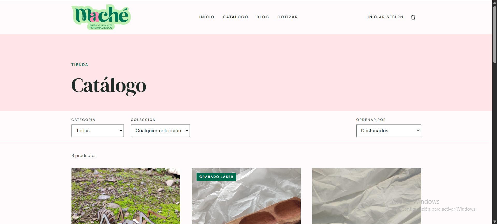 | 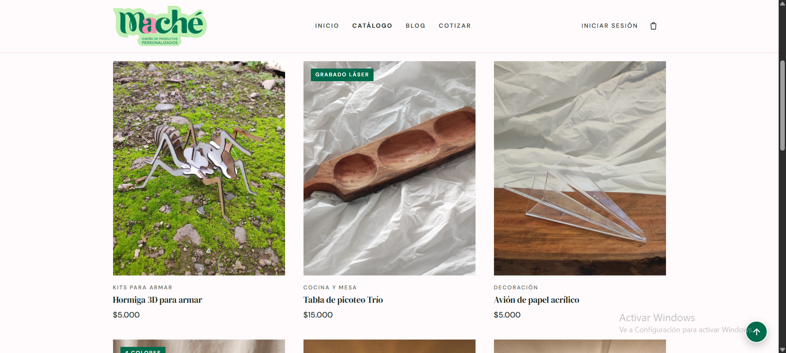 |

### Alan Zárate

Galería virtual y tienda de arte orientada a la exhibición de murales, comercialización de obras y solicitudes de cotización.

| Obras destacadas | Galería de murales |
|---|---|
| 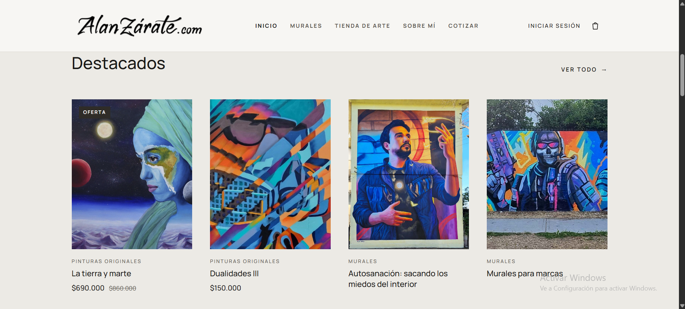 | 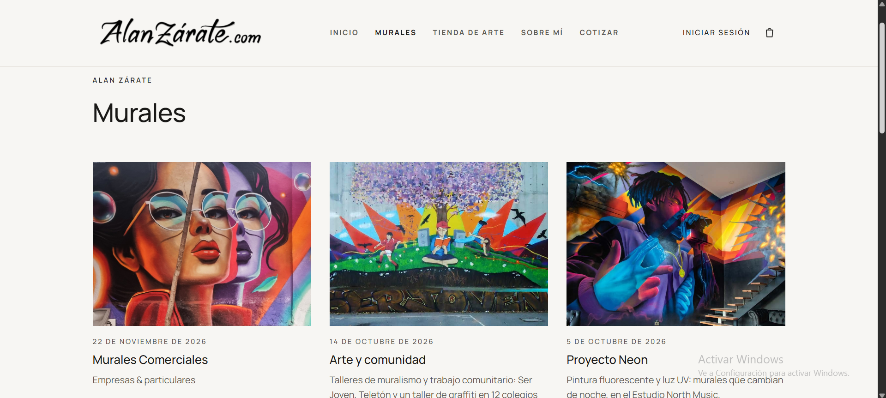 |

| Página de presentación | Solicitud de cotización |
|---|---|
| 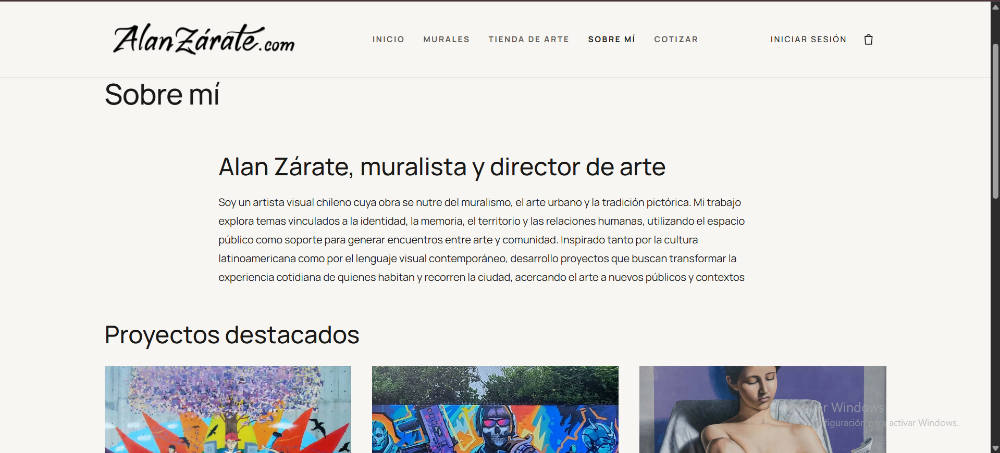 | 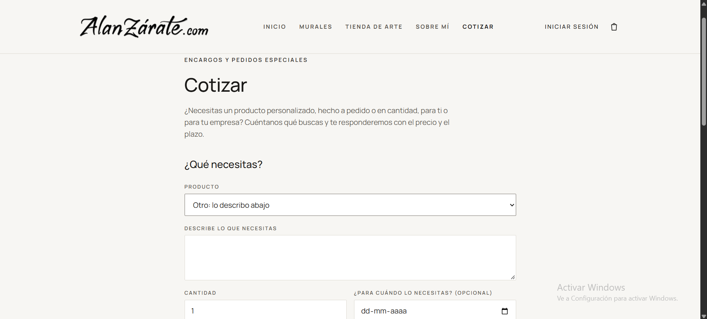 |

Ambas tiendas utilizan la misma plataforma, demostrando su capacidad de adaptación a diferentes rubros y necesidades comerciales.

## Funcionalidades principales

### Personalización de la tienda

- Configuración de colores y tipografías.
- Edición de la página de inicio.
- Personalización del logo e identidad visual.
- Configuración de imágenes y videos de portada.
- Activación y desactivación de módulos.
- Configuración de contenidos y secciones.
- Administración de páginas legales y pie de página.

### Administración del negocio

- Gestión de productos, categorías y colecciones.
- Administración de variantes, precios y stock.
- Gestión y seguimiento de pedidos.
- Administración de cotizaciones.
- Gestión de promociones y descuentos.
- Administración de reseñas.
- Publicación de contenido en el blog.
- Gestión de suscripciones.
- Indicadores de ventas y exportación de información.

### Experiencia del comprador

- Navegación y filtrado de productos.
- Selección de variantes.
- Administración del carrito.
- Compra como invitado o usuario registrado.
- Cotización de envíos.
- Selección de medios de pago y entrega.
- Seguimiento de pedidos.
- Gestión de preferencias de cookies.
- Diseño adaptable a dispositivos móviles.

## Panel de administración

El emprendedor puede administrar las funcionalidades de su tienda desde un panel centralizado.

| Panel de indicadores | Inventario |
|---|---|
| 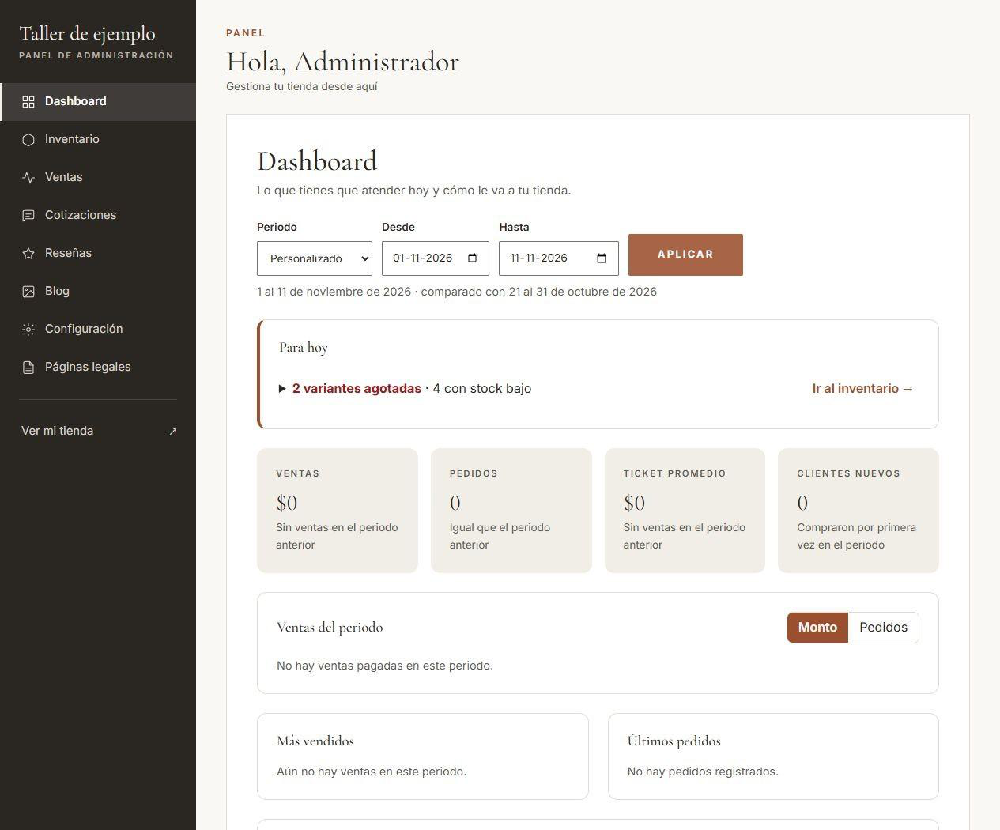 | 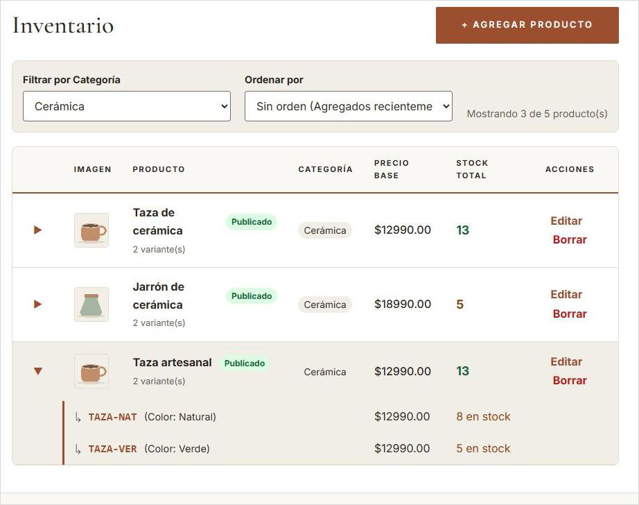 |

| Creación de productos | Gestión de variantes |
|---|---|
| 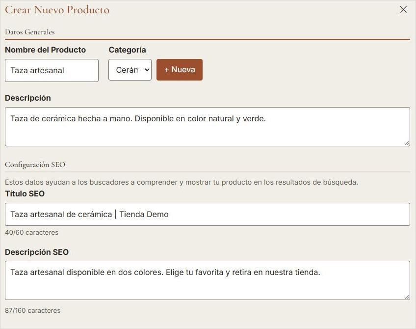 | 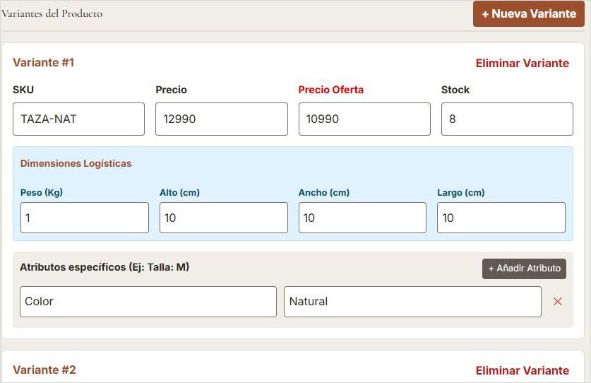 |

### Personalización de la página de inicio

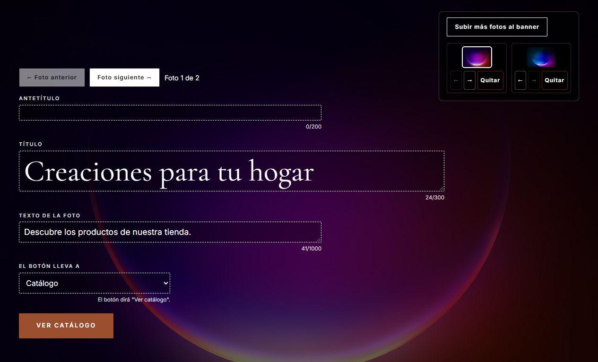

El sistema permite modificar los textos, las imágenes y el contenido de la portada directamente desde la interfaz de edición.

### Gestión de pedidos y casos especiales

| Pedidos que requieren revisión | Transferencias fuera de plazo |
|---|---|
| 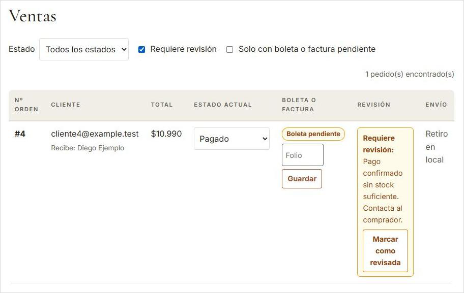 | 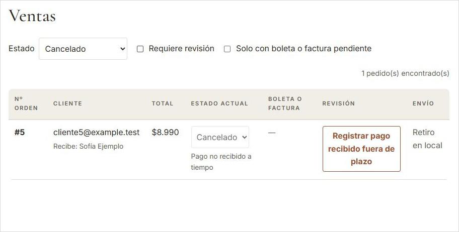 |

## Experiencia del comprador

| Catálogo | Selección de variantes |
|---|---|
| 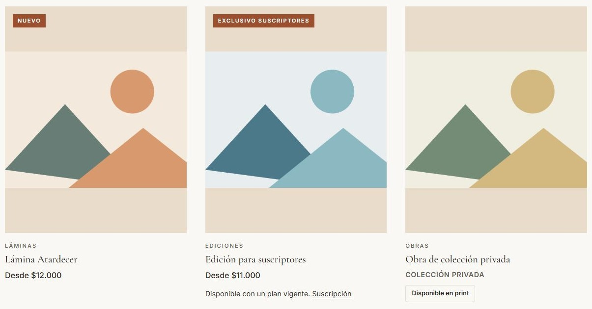 | 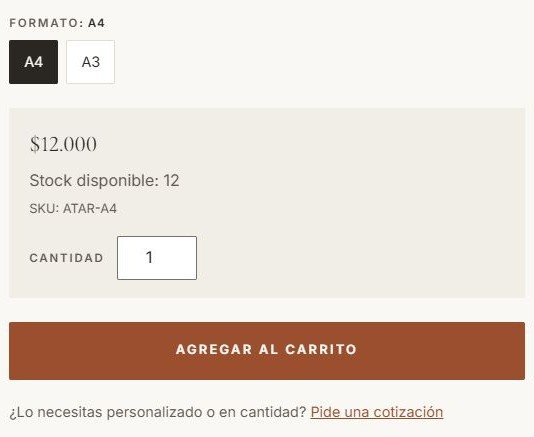 |

| Carrito de compras | Resumen de compra |
|---|---|
|  | 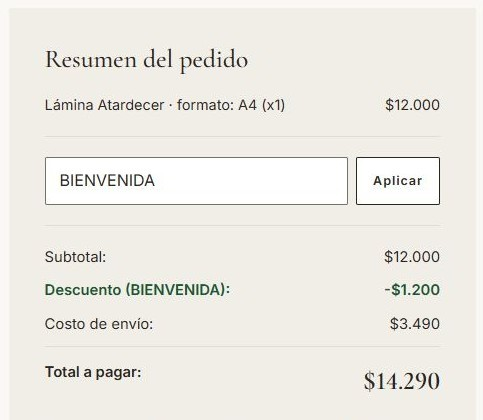 |

| Cotización de envío | Preferencias de cookies |
|---|---|
| 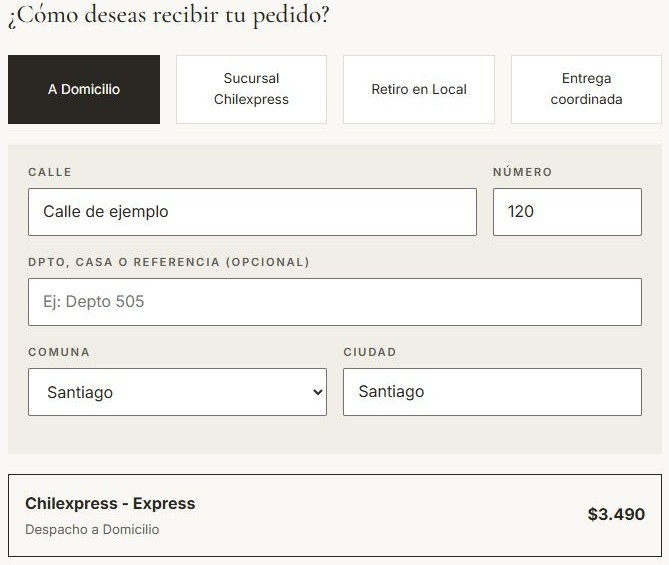 | 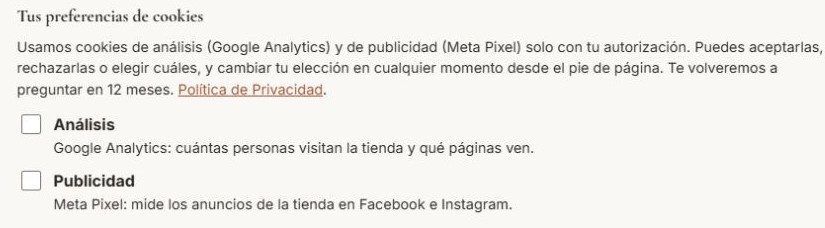 |

Las capturas de los flujos administrativos y de compra corresponden a ambientes de demostración.

## Arquitectura del sistema

El proyecto utiliza una arquitectura hexagonal para separar la lógica de negocio de los componentes de infraestructura y presentación.

### Tecnologías utilizadas

| Área | Tecnología |
|---|---|
| Backend | Python, Django y Django REST Framework |
| Frontend | React, JavaScript y Vite |
| Bases de datos | PostgreSQL y MongoDB |
| Autenticación | JWT y Google OAuth |
| Contenedores | Docker y Docker Compose |
| Control de versiones | Git y GitHub |
| Metodología | Scrum |

### Integraciones

- Chilexpress.
- Transbank.
- Google Analytics.
- Meta Pixel.
- Servicios de correo electrónico.

## Mi participación en el proyecto

**Roles: Scrum Master y desarrolladora, con participación en actividades de aseguramiento de calidad.**

### Gestión del proyecto

- Coordinación del equipo de desarrollo.
- Seguimiento de tareas y avances de los integrantes.
- Organización y seguimiento de los Sprints.
- Identificación de impedimentos y dependencias.
- Coordinación de reuniones.
- Seguimiento de requerimientos y entregables.

### Desarrollo de software

- Implementación de controles para modificar las cantidades y eliminar productos del carrito.
- Mejoras de accesibilidad en la selección de variantes.
- Correcciones relacionadas con la autenticación mediante Google.
- Incorporación de configuraciones para Google Analytics y Meta Pixel.
- Implementación del consentimiento de cookies.
- Desarrollo de funcionalidades para la personalización del pie de página.
- Implementación del registro de transferencias recibidas fuera de plazo.

### Aseguramiento de calidad

- Ejecución de pruebas funcionales.
- Revisión de funcionalidades implementadas.
- Identificación y seguimiento de incidencias.
- Validación de criterios de aceptación.
- Revisión de flujos de compra y cálculo de totales.
- Validación de la cotización de envíos.
- Revisión del comportamiento de las preferencias de cookies.
- Seguimiento de correcciones.

## Aseguramiento de calidad del proyecto

Durante el desarrollo se contemplaron actividades de verificación y validación, incluyendo pruebas funcionales y automatizadas.

El equipo utilizó pruebas de backend, frontend y de extremo a extremo, junto con herramientas de cobertura de código.

## Metodología de trabajo

El proyecto fue desarrollado utilizando Scrum, organizando el trabajo en Sprints y realizando un seguimiento continuo de los requerimientos, avances, impedimentos y entregables.

## Equipo de desarrollo

- Cristóbal Quezada.
- Emilio San Martín.
- Giuliana Zúñiga.
- Eidan Huiscán.
- Luciano Araya.
- Jhonatan de la Cruz.
- Javier Vallejos.

## Sobre este repositorio

Este repositorio corresponde a una copia del proyecto universitario desarrollado colaborativamente por el equipo Ecode, compartida con fines académicos y de portafolio profesional.

Las contribuciones individuales descritas corresponden a mi participación en el proyecto.

Se reconoce el trabajo de todos los integrantes del equipo en el desarrollo de EasyShop.

